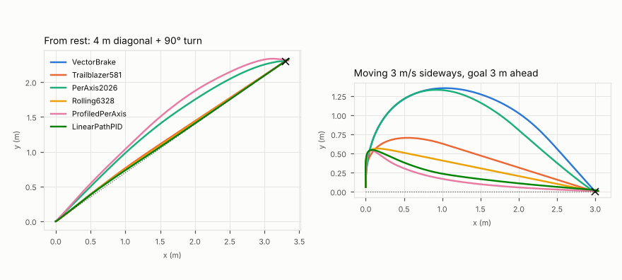
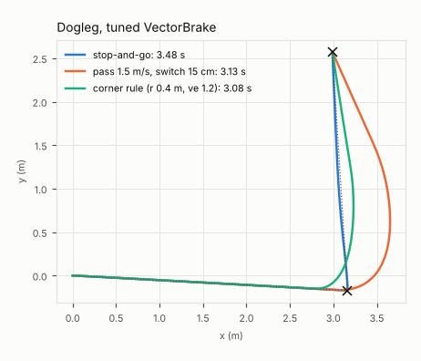

# Study: which drive-to-point law to ship

**Status:** simulation only, Oct 2026. Untested on a robot. Code is in
[`tools/alignsim/studies/controllers/`](../../../tools/alignsim/studies/controllers/). Every number below
comes from those scripts with fixed seeds (commands at the end).

**Question:** a swerve robot has to drive to a pose. It does this for path legs, for chained waypoints,
and for the final approach to a target whose goal keeps being refined by vision. Which control law
should the 2027 code use, and with which numbers?

## The answer

1. **Keep this repo's `DriveToPose` law (VectorBrake), but retune it.** The law is:
   - speed toward the goal = `min(vmax, √(v_end² + 2·decel·(d − v·react)), kp·d)`;
   - a **vector** acceleration limit on the change of the velocity command;
   - the same shape for heading.

   It was the only law that, with the same limits for everyone, had all of these at once:
   - no overshoot (0.1 cm p95);
   - an exact finish;
   - straight paths;
   - no command steps from a moving start;
   - 100 % success on the vision final approach;
   - graceful behavior with latency, 100 Hz odometry and goal jumps.
2. **The current repo numbers make the wheels slip.** `ANGULAR_ACCEL = 20 rad/s²` adds up to
   0.16 m/s per 20 ms loop at each module, on top of the 0.12 m/s translation step. That 0.28 m/s
   step breaks traction, and default `DriveToPose` slips about 300 ms per long move. The fix, with
   old → new values:

   | Java constant | now | ship | why |
   |---|---:|---:|---|
   | `MAX_SPEED` | 3.5 | 4.0 m/s | about 88 % of free speed (keep 3.5 if you prefer margin) |
   | `DECEL` | 3.0 | **6.0** m/s² | braking that is planned (4.0 in this study; raised in [Q5/Q6](#6-revisit-how-hard-can-it-accelerate-q5-q6)) |
   | `ACCEL` | 6.0 | **10.0** m/s² | hard limit. **Must stay above `DECEL`**. 5.0 in this study; raised in [Q5/Q6](#6-revisit-how-hard-can-it-accelerate-q5-q6) |
   | `KP` | 4.0 | **6.0** 1/s | 0.2 s faster finish. 8 or more starts a small limit cycle |
   | `REACTION_TIME` | 0.05 | 0.05 s | use **0.10 on SystemCore without a CANivore** (100 Hz) |
   | `MAX_OMEGA` | 6.0 | 6.0 rad/s | |
   | `ANGULAR_DECEL` | 8.0 | **6.0** rad/s² | |
   | `ANGULAR_ACCEL` | 20.0 | **8.0** rad/s² | the slip fix. **Must stay above `ANGULAR_DECEL`** |
   | `KP_HEADING` | 5.0 | 5.0 1/s | |
   | *new* heading reaction time | — | **0.05 s** | brake heading early, like `REACTION_TIME`. Removes heading overshoot with latency |
   | *new* stop deadband | — | **3 mm / 0.3°** | command zero inside it. Kills a sub-mm end limit cycle |
   | `WAYPOINT_TOLERANCE` | 0.15 m | corner rule | see point 4 |

   - **Result in the sim:**
     - slip on long moves drops from 301 to 26 ms;
     - the final approach takes 1.58 s instead of 1.86 s, with 100 % success;
     - end jitter drops from 0.03 to 0.00 cm/s.
   - **How it reads in code:** the change is constants plus about 6 lines, so the law stays the same
     shape for teaching.
3. **Three rules make this law safe. They carry over to the real robot even when the numbers
   change:**
   - **Limit ≥ planned brake + margin.** Use `ACCEL ≥ DECEL + ~1` and `ANGULAR_ACCEL > ANGULAR_DECEL`.
     If the limiter is lower than the braking curve, the robot can't follow it. `accel 3 < decel 4`
     overshoots up to 67 cm, and `waccel 6 < wdecel 10` overshoots 50° of heading.
   - **Per-loop step budget at 50 Hz.** Each new setpoint makes the onboard velocity loop push
     harder than the average for a moment, so big per-loop steps slip the wheels. Running the law at
     250 Hz removes most of it (Q6). Don't fix it by lowering the slip current: weight transfer needs
     the loaded wheels to push harder (Q6).
   - **Brake early for delay, translation and heading both.** Set `react` ≈ total actuation delay.
4. **Pass-through waypoints: use the corner rule, not "end speed at a 15 cm switch".**
   - **The rule.** Pick a switch radius `r = min(0.4 m, 40 % of the shorter leg)`. Then set the end
     speed `ve = √(DECEL · r / tan(turn/2))`. **Brake to `ve` at the switch circle**, not at the
     waypoint. This is the tightest arc the acceleration limit allows, so it fits inside the corner.
   - **Against stop-and-go:** routes are **11–26 % faster**. Slip is zero on the 60° and 90° turns,
     and 146 ms on the 135° hairpin.
   - **Against today's `withEndSpeed(1.5)` + 15 cm switch:** path deviation falls from 54–56 cm to
     13–21 cm, and the route is still faster.
5. **Runner-up: 5712's 2026 `PerAxis2026`, but only with its deadbands cut from 2 cm/2° to
   0.5 cm/0.5°.**
   - **Strengths:** it is the fastest on the final approach (1.54 s) and has the least slip, thanks
     to its friction-circle limit shared with rotation.
   - **Why it is second:** it bends diagonal paths (57 cm p95 off the straight line). It overshoots
     about 2 cm, and is far more latency-sensitive: 12 cm and 10° of overshoot at +40 ms, against
     2.5 cm and 4° for VectorBrake. With no
     linear zone, it chatters under pose noise (8.8 cm/s, 305 ms slip with 1 cm noise).
   - **As shipped (2 cm/2°):** 38 % of final approaches were *false done*.
6. **Don't use the profile-based laws (6328 rolling, WPILib per-axis, CTRE LinearPath) for this job.**
   - **Without a vector limit**, they step the velocity command whenever the robot isn't already
     moving the way their profile assumes. The wheels slip and wheel odometry is off by 61–146 cm
     (p95) after a moving start. That alone gave 6328 a **79 % false-done** rate on the vision final
     approach, because the local goal lives in the odometry frame.
   - **With a vector limit bolted on**, their setpoint runs away from the robot, and they overshoot
     26–158 cm.
   - The brake-curve law has no internal setpoint. It recomputes from where the robot actually is,
     every loop.

## Setup

**Two harnesses:**

- **Move bench** ([`bench.py`](../../../tools/alignsim/studies/controllers/bench.py)). It is used for
  Q1, Q3 and most of Q4, and isolates the controller:
  - It has `World.run`'s exact thread timing: 500 Hz physics, the 250 Hz odometry thread that applies
    the newest request, a 50 Hz loop with jitter, and the actuation delay. It has no cameras.
  - The controller sees the **true pose at the last odometry tick** (perfect localization). Q4 adds
    noise, or runs the controller on wheel odometry instead.
  - Per-trial wheel-radius and gyro-scale errors are zero, so odometry error comes from slip.
- **Full `World`** with `Strategy(tracker=default_tracker(frame="odom"))` and the default `Scenario`,
  used for Q2 and part of Q4. This means:
  - the robot starts 2.8 m out at 1.5 m/s;
  - two Limelights, the PoseEstimator, and the odom-frame tag tracker;
  - the element is off the map.

**Matched limits.** Each law's published defaults differ, so the main comparison gives every law the
same limits:

- translation: `vmax` 4.0 m/s, accel 5 m/s² (VectorBrake: plan 4, limit 5);
- heading: 6 rad/s and 12 rad/s²;
- per-axis laws get `vmax/√2` and `accel/√2` per axis, so no direction exceeds the vector limits.

Section 1 also shows "as ported" defaults.

**Long-move cases** ([`q1_long.py`](../../../tools/alignsim/studies/controllers/q1_long.py)):

- a random direction and distance of 1–6 m;
- a heading change of 0–180° with a random sign;
- start from rest, or moving at 0.5–3 m/s in a random direction.

There are 150 cases of each, and every law sees the same cases and seeds.

**Metrics (truth-based):**

| metric | meaning |
|---|---|
| t 5cm | first time within 5 cm and 2° |
| t settle | time after which it stays within 2 cm and 1° to the end (median of settled runs) |
| overshoot | how far it goes past the goal along the approach direction, measured from 0.3 m out |
| final error | at t = 7 s |
| slip | time any wheel is sliding (`plant.slip_time`) |
| odo err | wheel odometry vs truth at the end |
| pk acc / jerk | peak commanded acceleration (m/s²) and jerk (m/s³) at 50 Hz |
| path dev | max distance from the straight start→goal line |

Q2 uses `experiment.summarize`.

**Compute:** about 39 CPU-minutes, one process.

## 1. Long moves (path legs), perfect localization



**Matched limits, n = 150 per start type.** Median times; overshoot, error and path deviation are p95.

| law | rest: t 5cm / settle | overshoot cm | final err | path dev cm | slip ms | moving: t settle | moving: slip ms | moving: odo err p95 cm | moving: max cmd accel | median pk jerk (rest / moving) |
|---|---|---:|---|---:|---:|---:|---:|---:|---:|---|
| **VectorBrake** | 1.72 / 1.88 | **0.1** | **0** | 9 | 159 | 2.10 | 161 | **1.7** | **5** | **260 / 210** |
| Trailblazer581 | 1.68 / 1.86 | **0.1** | **0** | 10 | 244 | 1.95 | 525 | 146 | 302 | 1000 / 5059 |
| PerAxis2026 | 1.68 / 1.70* | 2.1 | 1.2 cm, 1.7° | 58 | 6 | 1.89* | 7 | 1.6 | 5 | 499 / 500 |
| Rolling6328 | 1.44 / 1.58 | 3.4 | 0.9 cm | 9 | 372 | 1.67 | 517 | 74 | 141 | 1026 / 2964 |
| ProfiledPerAxis | 1.63 / 2.08 | 5.1 | 0 | 79 | 247 | 2.39 | 248 | 2.3 | 86 | 288 / 270 |
| LinearPathPID | 1.44 / 1.90 | 6.6 | 0 | 7 | 242 | 2.03 | 403 | 61 | 150 | 332 / 2471 |

\* PerAxis2026 only settles inside 2 cm/1° in 51–55 % of runs, because its 2 cm/2° deadbands stop it
short.

**Tuning and the minimal fix of each failure, n = 100** (the first 100 of the same cases;
[`q1b_fixes.py`](../../../tools/alignsim/studies/controllers/q1b_fixes.py)):

| law | rest: t settle | rest: overshoot p95 cm | rest: path dev cm | rest: slip ms | moving: t settle | moving: overshoot cm | moving: slip ms | moving: odo p95 cm |
|---|---:|---:|---:|---:|---:|---:|---:|---:|
| **VectorBrake tuned** (kp 6, heading 6/8) | **1.79** | **0.1** | **9** | **26** | **1.90** | **0.1** | **34** | 1.5 |
| PerAxis2026, deadbands 0.5 cm/0.5° | 1.84 | 2.6 | 57 | 7 | 1.94 | 2.5 | 10 | 1.6 |
| 581 + vector limit, no 0.5 floor | 2.29 | 18.5 | 19 | 144 | 2.48 | 18.2 | 180 | 1.3 |
| 6328 + vector limit | 2.83 | 26.5 | 27 | 214 | 3.24 | 88 | 214 | 1.5 |
| LinearPathPID + vector limit | 2.63 | 44 | 44 | 216 | 3.17 | 158 | 217 | 1.2 |
| *VectorBrake repo defaults (ported, n=150)* | 1.94 | 0.1 | 8 | 301 | 2.14 | 0.1 | 290 | 2.9 |

**What this shows:**

- **VectorBrake finishes exactly with no overshoot from every start.** Its commanded acceleration
  never exceeds the limit, even when the robot starts at 3 m/s going the wrong way.
- **Where its slip came from.** About 80 % of VectorBrake's slip happens while turning. It comes from
  the heading rate steps, not from translation: pure translation never slipped. `ANGULAR_ACCEL` 8
  with `ANGULAR_DECEL` 6 cuts slip by 6× at no time cost.
- **Laws without a vector limit wreck odometry from a moving start.** This applies to 581, 6328 and
  LinearPath:
  - **Command steps.** A 30–300 m/s² step in one loop flips the modules and spins the wheels.
    Encoders then over-read by up to 1.5 m.
  - **Q1 isn't affected, but a real robot would be.** The Q1 controller sees truth. On a real robot,
    that error goes into the pose (wheel-only) or into the local tag frame. Q2 shows the cost.
- **The swing-out in the right plot is physics, not the controller.** Stopping 3 m/s sideways at
  5 m/s² takes 0.9 m. VectorBrake's vector limit shares that acceleration with speeding up toward
  the goal, so it swings 1.35 m. The step-command laws swing less only because they slide the
  wheels.
  - **A tried fix:** a "cancel sideways speed first" variant (`perp_first`) cut the swing to 1.06 m
    but cost 0.17 s on average, so it is not recommended.
- **Per-axis laws bend paths.** PerAxis2026 goes 58 cm off a diagonal and ProfiledPerAxis 79 cm,
  because each axis finishes on its own schedule.
- **Time differences between the clean laws are about 0.1 s.**
  - 6328 and LinearPath *look* faster to 5 cm because they overshoot through it.
  - The VectorBrake defaults lose about 0.2 s to the low `KP` (4): the gentle zone starts 0.4–0.5 m
    out. `KP` 6 recovers most of that.

## 2. Final approach under realistic localization

Default `Scenario`, `Strategy(tracker=default_tracker(frame="odom"))`, controller varied.

- **Goal jumps.** The goal reported by the tracker starts 1–5 cm off, in a random direction fixed per
  seed. It snaps to the tracker's own estimate when the robot first gets within 5 cm (`JumpTracker`
  in [`approach.py`](../../../tools/alignsim/studies/controllers/approach.py)).
- **The lock jump is always there.** The jump from the map goal to the tracker goal happens in every
  run anyway.

| law | success % | false done % | t done | pos@done p95 cm | jitter cm/s | slip ms | **with goal jumps:** success % / t done |
|---|---:|---:|---:|---:|---:|---:|---|
| VectorBrake (matched, kp 4) | 100 | 0 | 1.77 | 0.83 | 0.02 | 8 | 100 / 1.78 |
| VectorBrake (repo defaults) | 100 | 0 | 1.86 | 0.80 | 0.03 | 32 | 100 / 1.85 |
| VectorBrake kp 8, heading 6/8 | 100 | 0 | 1.52 | 0.73 | **0.90** | 0 | 100 / 1.59 |
| **VectorBrake tuned (kp 6, heading 6/8)** | **100** | **0** | **1.59** | 0.77 | 0.06 | **0** | 100 / 1.61 |
| **…+ heading react 0.05 + 3 mm/0.3° deadband** (n=30) | **100** | **0** | **1.58** | 0.71 | **0.00** | **0** | — |
| Trailblazer581 | 100 | 0 | 1.82 | 0.76 | 0.01 | 107 | 100 / 1.80 |
| 581 + vector limit, no floor | 99 | 1 | 2.13 | 0.90 | 0.01 | 21 | 100 / 2.14 |
| PerAxis2026 (2 cm/2° deadbands) | 50 | **38** | 1.50 | 1.35 | 0.00 | 0 | 47 / 1.52 |
| PerAxis2026, deadbands 0.5 cm/0.5° | 100 | 0 | **1.54** | 0.75 | 0.00 | 0 | 100 / 1.58 |
| Rolling6328 | 21 | **79** | 1.26 | 3.68 | 0.00 | 311 | 10 / 1.28 |
| 6328 + vector limit | 100 | 0 | 2.55 | 1.27 | 0.00 | 62 | 100 / 2.59 |
| ProfiledPerAxis | 100 | 0 | 1.97 | 0.72 | 0.03 | 129 | 100 / 1.97 |
| LinearPathPID (goal frozen) | 57 | 16 | 1.82 | 1.40 | 0.03 | 48 | 58 / 1.82 |

n = 100 and 60 (jumps) for the Q2 laws, 80 and 40 for the add-on rows
([`q2_approach.py`](../../../tools/alignsim/studies/controllers/q2_approach.py),
[`q2b_addendum.py`](../../../tools/alignsim/studies/controllers/q2b_addendum.py)).

**What this shows:**

- **Every law with a gentle zone near the goal takes 1–5 cm goal jumps in stride:** VectorBrake, 581,
  WPILib per-axis, and the fixed PerAxis2026 all hold 100 %, losing at most 0.07 s.
- **6328's false dones come from slip, not from its profile.**
  - **Without a limit:** it reaches the goal fastest (1.26 s) but slips 311 ms near the end. The
    slip moves the odometry frame that the local goal lives in, so the robot thinks it is within
    2 cm when it is 3–4 cm off. Checked on 6 seeds: odometry drifts 3.1–6.2 cm between tracker lock
    and "done", against 0.3–1.7 cm with a vector limit.
  - **With a vector limit:** the same law scores 100 %.
- **PerAxis2026's 2 cm / 2° deadbands equal the finish tolerance.** It parks right at the edge, and
  vision noise decides whether it is truly in.
- **LinearPathPID freezes its goal at the first loop.** That is the map goal, before the tracker
  locks, so it inherits the field error: 57 % success, and 27 % never finish because the measured
  goal never comes within tolerance.
- **kp 8 gave the fastest VectorBrake (1.52 s), but it isn't stable at the finish.** It ends in a
  sub-millimetre limit cycle, about 0.12 s period, that shows up as 0.9 cm/s motion. Cause: the
  loop's total delay (about 45 ms) puts kp 8 at the kp·T ≈ 1/e edge, and the drive's kS voltage kick
  amplifies tiny commands. kp 6 has none, and the 3 mm deadband removes the remainder.

## 3. Waypoint chaining: stop-and-go vs pass-through



**The routes** start from rest at (0, 0), with each point jittered ±0.2 m and ±15° per trial, n = 30
each ([`q3_route.py`](../../../tools/alignsim/studies/controllers/q3_route.py)):

| route | waypoints | turns |
|---|---|---|
| zigzag | 3 | about 60° |
| dogleg | 2 | 90° |
| hairpin | 2 | 135° |

**How a leg ends:**

- **Stop-and-go:** every leg ends with `isFinished` (2 cm, 2°, < 5 cm/s).
- **Pass-through:** the next leg starts within the switch radius. Each leg is a fresh controller
  seeded from the measured velocity, just like chaining Java commands.

| config | zigzag t / path dev cm | dogleg t / dev | hairpin t / dev | slip ms (3 routes) | odo p95 cm (worst) |
|---|---|---|---|---|---:|
| VB tuned, stop-and-go | 4.68 / 4 | 3.50 / 4 | 3.51 / 8 | 22 / 46 / 69 | 0.6 |
| VB tuned, pass 1.5 m/s @ 15 cm (today's `withEndSpeed`) | 3.64 / 56 | 3.04 / 54 | 3.30 / 55 | 0 / 0 / 162 | 1.9 |
| VB tuned, pass 1.5 @ 40 cm | 3.47 / 72 | 2.93 / 59 | 3.25 / 63 | 1 / 1 / 176 | 2.2 |
| VB tuned, pass 2.5 @ 40 cm | 3.72 / 107 | 3.12 / 102 | 3.44 / 99 | 33 / 16 / 209 | 2.5 |
| **VB tuned, corner rule** | **3.45 / 21** | **3.00 / 15** | **3.12 / 13** | **0 / 0 / 146** | 1.5 |
| VB repo-like (matched), pass 1.5 @ 15 cm | 3.80 / 55 | 3.21 / 54 | 3.48 / 55 | 228 / 332 / 423 | 2.1 |
| PerAxis2026, pass 1.5 @ 15 cm | 3.47 / 42 | 2.99 / 47 | 3.22 / 50 | 2 / 0 / 1 | 1.5 |
| Rolling6328, pass 1.5 @ 15 cm | 2.96 / 13 | 2.55 / 16 | 2.75 / 14 | 1153 / 705 / 818 | **40** |
| Trailblazer581, pass 1.5 @ 15 cm | 3.55 / 6 | 3.05 / 9 | 3.21 / 12 | 1365 / 783 / 1035 | **64** |
| 581 fixed, pass 1.5 @ 15 cm | 3.97 / 48 | 3.61 / 57 | 3.90 / 51 | 486 / 438 / 313 | 1.6 |
| LinearPathPID, pass 1.5 @ 15 cm | 3.24 / 10 | 3.02 / 12 | 3.39 / 21 | 1119 / 660 / 711 | **46** |
| ProfiledPerAxis, pass 1.5 @ 15 cm | 4.08 / 103 | 3.56 / 45 | 3.95 / 119 | 618 / 510 / 757 | 22 |

**What this shows:**

- **Yes, the law can pass a waypoint at speed and continue smoothly.**
  - **The catch with today's rule:** the robot arrives *at* the waypoint at `ve`. The vector limit then
    redirects it, so it swings about 55 cm outside the corner.
  - **The corner rule** turns early on the tightest arc the limit allows. It cuts the corner by
    13–30 cm, stays within 13–21 cm of the polyline, and is the fastest clean option:
    - **11–26 % faster than stop-and-go;**
    - **0.04–0.2 s faster than the 15 cm switch.**
- **The fast-looking rows (6328, 581, LinearPath) change direction instantly at each handover.** They
  slip 0.7–1.4 s per route, and wheel odometry ends 40–64 cm off. Even 6328's stop-and-go is quick
  partly because it overshoots *through* each stop waypoint, at about 0.65 m/s at closest approach,
  and comes back, slipping 0.5–0.9 s per route.
- **PerAxis2026 chains cleanly (no slip),** but bends 42–50 cm and still ends 1.1–1.3 cm off.

## 4. Sensitivity and tuning

**VectorBrake knobs, one at a time from the matched base.** Bench, 80 rest + 80 moving starts
([`q4_tune_vb.py`](../../../tools/alignsim/studies/controllers/q4_tune_vb.py),
[`q4_extra.py`](../../../tools/alignsim/studies/controllers/q4_extra.py)):

| change | t settle | overshoot p95 cm | heading overshoot p95 | slip ms |
|---|---:|---:|---:|---:|
| base (kp 4, decel 4 / accel 5, heading 10/12) | 2.00 | 0.1 | 0.0° | 146 |
| kp 6 / 8 / 12 | 1.84 / 1.81 / 1.80 | 0.1 | 0.0° | 145 |
| decel 5 / accel 6 | 1.86 | 0.1 | 0.0° | **216** |
| react 0 / 0.1 | 1.78 / 2.06 | 0.1 | 0.0° | 147 |
| heading 8/8 or 6/6 (decel = limit) | 2.00 | 0.1 | **7.9–8.3°** | 9–32 |
| heading 10/6 (limit < decel) | 2.16 | 0.1 | **50°** | 14 |
| **kp 8, heading 6/8** (n = 60 + 60) | 1.82 | 0.1 | 0.1° | **26** |
| kp 8, heading 8/12 | 1.83 | 0.1 | 0.1° | 130 |

**Latency and odometry rate.** Bench, 30 rest + 30 moving starts
([`q4_sensitivity.py`](../../../tools/alignsim/studies/controllers/q4_sensitivity.py)). The cells are
overshoot p95 in cm / heading overshoot p95:

| condition | VB tuned | PerAxis2026 db 0.5 | 581 fixed | 6328 + limit |
|---|---|---|---|---|
| baseline (250 Hz, 2 ms) | **0.1 / 0.0°** | 1.8 / 3.0° | 18 / 0.2° | 79 / 17° |
| odometry 100 Hz (SystemCore CAN 2.0) | **0.1 / 0.0°** | 4.0 / 6.6° | 22 / 0.5° | 80 / 22° |
| actuation +20 ms | **0.3 / 0.8°** | 6.0 / 5.9° | 27 / 1.2° | 94 / 29° |
| 100 Hz + 20 ms | **0.7 / 2.1°** | 7.8 / 6.2° | 30 / 1.8° | 96 / 31° |
| actuation +40 ms | **2.5 / 4.2°** | 12.4 / 10.5° | 35 / 3.8° | 108 / 40° |

**Brake early for delay** (VB tuned, kp 6):

| condition | `wreact = 0.05` | `react = 0.10` |
|---|---|---|
| 100 Hz + 20 ms | heading overshoot 2.1° → 0.1° | position overshoot 0.7 → 0.3 cm, +0.08 s |
| +40 ms | heading overshoot 4.2° → 0.0° | 2.5 → 0.6 cm, +0.06 s |
| baseline | no time cost | — |

**On SystemCore without a CANivore:** 100 Hz odometry costs VectorBrake almost nothing in time. It
raises the odometry error from 1.4 to 2.2 cm p95 per move. Use `react` 0.1 there.

**Pose noise: the √ law's gain near zero** (VB tuned base, kp varied; true pose + white noise each
loop):

| condition | kp 4 | kp 8 | kp 12 | √ only (kp ∞) |
|---|---|---|---|---|
| 1 cm / 0.5° white noise: final err p95 / jitter cm/s / slip ms | 0.43 / 2.6 / 25 | 0.72 / 5.0 / 50 | 1.06 / 6.3 / 121 | 1.31 / **9.3** / **173** |
| +40 ms: overshoot p95 cm / jitter cm/s | 0.8 / 2.4 | 2.5 / 2.7 | 2.5 / 3.5 | 2.5 / 5.4 |

PerAxis2026, which has no linear zone, gets 1.30 cm / 8.8 cm/s / **305 ms slip** under the same 1 cm
noise. A 2 cm, 0.3 s "wander" (vision-like) noise defeats every law: 35–55 % settle, about 3.5 cm
error. That noise is the localization's job, not the controller's.

**Plant assumptions.**

- **Softer tread** (`lateral_stiffness` 1500 instead of 4000):
  - **Slip:** fewer slip events (VB 27 → 16 ms).
  - **Odometry:** more unseen lateral creep, so error rises to 3.6 cm.
  - **Ranking:** unchanged.
- **Driving on wheel odometry alone:** VB ends 1.4 cm p95 off and PerAxis 1.7 cm. That gap is
  exactly their odometry error.

**Final approach with the top two under timing changes.** Full World, n = 40
([`q4_world.py`](../../../tools/alignsim/studies/controllers/q4_world.py),
[`q4_deadband.py`](../../../tools/alignsim/studies/controllers/q4_deadband.py)):

| condition | VB ship: success / t done / jitter | + 3 mm deadband (n=30) | PerAxis2026 db 0.5: success / t done / jitter |
|---|---|---|---|
| default timing | 100 / 1.59 / 0.06 (Q2b: no `wreact`, n=80) | 100 / 1.58 / **0.00** | 100 / 1.54 / 0.00 (n=80) |
| odometry 100 Hz | 100 / 1.56 / 1.58 | — | 100 / 1.53 / 0.00 |
| actuation +20 ms | 100 / 1.48 / 2.12 | — | 100 / 1.51 / 0.00 |
| 100 Hz + 20 ms | 100 / 1.46 / 2.45 | 100 / 1.46 / **0.00** | 100 / 1.59 / 0.00 |

Other kp settings on the default final approach, n = 40:

- **kp 12:** 100 % success, 1.47 s, 1.24 cm/s jitter.
- **√ only:** 100 % success, 1.48 s, 1.84 cm/s jitter.

The final-approach localization is smooth enough that the gain near zero shows up as jitter, not
failures.

## 5. What breaks each law

**VectorBrake (this repo):**

- **Limiter below the braking curve.** The braking plan assumes the limiter can follow it, so it
  overshoots when it can't:
  - accel 3 < decel 4: **67 cm** overshoot;
  - `waccel` 6 < `wdecel` 10: **50°**;
  - `waccel` = `wdecel`: about 8° (no margin for delay).
- **Uncoordinated translation and heading limits** slip the wheels at every 50 Hz step. This is the
  repo default: 300 ms per move.
- **High `KP`.** The √ law's infinite gain at zero, or simply kp ≥ 8, amplifies noise and delay into
  jitter: 9.3 cm/s at kp ∞ with 1 cm noise. Keep kp at about 6 and a 3 mm deadband.
- **Moving starts.** The vector limit shares acceleration between "stop going sideways" and "go
  toward the goal", so from a fast sideways start it swings wide (1.35 m vs 0.9 m minimum). This
  is acceptable; the fix costs time.
- **Pass-through as written** swings about 55 cm wide at corners. Use the corner rule.

**Trailblazer581:**

- **The speed limit is a scalar.** Nothing limits a *change of direction*. From a moving start it
  flips direction in one loop (max 302 m/s² commanded), slips 0.5 s, and wheel odometry ends up to
  1.5 m off.
- **The 0.5 m/s floor** makes every start from rest a 25 m/s² step (0 → 0.5 m/s in one loop).
  Removing it cuts the rest-start command step from 25 to 10 m/s² (and slip from 244 to 194 ms).
- **Its braking curve `√(2·amax·d)` has no reaction margin** and uses the same number as its
  limit. Bolt on a vector limit and it overshoots 18 cm (35 cm at +40 ms).
- **Heading.** As ported, the ProfiledPID heading has no setpoint-velocity feedforward. Check 581's
  real code before reusing it.

**PerAxis2026 (5712's 2026 code):**

- **Each axis brakes on its own,** so diagonal paths bend (57 cm).
- **Its deadbands (2 cm/2°) equal typical finish tolerances:** 38 % false done. 0.5 cm/0.5° fixes it.
- **No linear zone,** so under pose noise the √ law chatters (8.8 cm/s, 305 ms slip).
- **Latency-sensitive:** 12 cm and 10° of overshoot at +40 ms, even with its 0.1 s react buffer.

**Rolling6328:**

- **The profile is re-seeded from its own last setpoint, not the robot.**
  - **No vector limit:** the sideways part of a moving start is dropped in one loop. That gives
    60–140 m/s² steps and 74 cm of odometry error.
  - **Near the goal:** it slips 311 ms during the final approach, giving 79 % false done.
  - **With a limit:** the setpoint runs ahead of the held-back robot, giving 26–88 cm of overshoot.
- **The 1 cm "at goal" deadband** leaves it 0.9 cm off.

**ProfiledPerAxis (WPILib):**

- **Independent x/y profiles make L-shaped paths** (79 cm from rest, 165 cm from moving starts).
  Per-axis limits are either √2 too fast on diagonals or too slow on the axes.
- **P on a setpoint the robot lags** overshoots 5 cm.

**LinearPathPID (CTRE):**

- **The goal is frozen at the first loop.** Refinements and the tracker lock are ignored: 57 %
  success and 27 % never finish on the vision approach.
- **Velocity off the line is dropped at the start:** a 150 m/s² step and 61 cm of odometry error.
- **It is time-based.** If the robot falls behind (slip, a push), the setpoint keeps going: 6.6 cm
  overshoot.

## 6. Revisit: how hard can it accelerate? (Q5, Q6)

Asked after the study: aren't 5 m/s² and 4 m/s² too conservative, when the tires can do about 1 g?
Full tables: [`results/q5_accel.md`](../../../tools/alignsim/studies/controllers/results/q5_accel.md).

- **Yes.** ACCEL 10 / DECEL 6 is 0.23–0.28 s faster per move than 5 / 4.
- **Q5 first suggested lowering the slip current to ~55–60 A to stop the slip. That was wrong** (Q6):
  the Q5 plant had no weight transfer. With it, a low slip current starves the loaded wheels and is
  slower with 2–3× the odometry error. Keep it high (~2× grip) and limit acceleration in the command,
  as 5712 did in 2026.
- **Braking is the knob to keep moderate.** On the final tag approach, DECEL 9 drops the very hard
  world from 97% to 85–89% (the robot covers the last stretch fast, so timing error becomes depth
  error). DECEL 6 keeps 98–99% and is still 0.15–0.2 s faster than before.
- **Hard reversals from a moving start still slip** (~400 ms, ~11 cm odometry error) while the modules
  re-steer. A wheel-only auto that starts moves at speed is better with ACCEL ~7.

**Q6, physics and timing** ([`results/q6_physics.md`](../../../tools/alignsim/studies/controllers/results/q6_physics.md)):

- **Weight transfer is the big effect.** Velocity-controlled modules push about equally, so the light
  wheels slip first: with a 0.2 m CG the equal-force limit is only ~6 m/s².
- **250 Hz control** (the law run in CTRE's odometry thread) removes the 50 Hz setpoint-step slip:
  clean to 8 m/s² without weight transfer.
- **Load-split wheel force feedforward** (CTRE per-module forces, split by expected load) is the
  per-module win: with a 0.2 m CG at 6–8 m/s² it cuts slip 3–4× and halves odometry error, and the robot
  follows its command within 0.05 m/s.
- **At 10 m/s² with a realistic CG, some wheels slip whatever you do.** Alignment still works (96–99%)
  because the tag tracker re-anchors; odometry takes 4–7 cm per hard move, which vision corrects.
- **Don't put Motion Magic velocity on swerve drive motors:** turning while driving needs wheel speeds to
  change faster than the chassis accelerates, so the ramp makes wheels scrub.

**Ships:** `ACCEL` 10, `DECEL` 6, slip current 120 A. The heading limits stay at 6 / 8.

## The law to ship, in full

```
each loop (dt = 0.02):
  d, dir   = distance and unit vector to goal;  e = heading error (−π..π)
  v_now    = |commanded velocity|;  ω_cmd = commanded ω
  brake_d  = max(0, d − v_now·REACT − (endSpeed > 0 ? switchRadius : 0))
  speed    = min(VMAX, √(endSpeed² + 2·DECEL·brake_d))
  if endSpeed == 0: speed = min(speed, KP·d);  if d < 3 mm: speed = 0
  ω_target = sign(e)·min(WMAX, √(2·WDECEL·max(0, |e| − |ω_cmd|·WREACT)), KP_W·|e|);  if |e| < 0.3°: ω_target = 0
  commanded velocity moves toward speed·dir by at most ACCEL·dt (as one vector)
  commanded ω moves toward ω_target by at most WACCEL·dt

VMAX 4.0  DECEL 6.0  ACCEL 10.0  KP 6  REACT 0.05 (0.10 at 100 Hz)   (slip current high, ~2x grip)
WMAX 6.0  WDECEL 6.0 WACCEL 8.0 KP_W 5 WREACT 0.05
waypoint: r = min(0.4, 0.4·shorter leg);  endSpeed = √(DECEL·r / tan(turn/2));  hand over inside r
```

In the study code this is `VectorBrakeX(vmax=4, decel=4, accel=5, kp=6, react=0.05, wmax=6, wdecel=6,
waccel=8, kp_w=5, wreact=0.05, deadband=0.003, wdeadband=radians(0.3))`. Pass-through uses
`switch_radius`.

## Caveats

- **Traction and the velocity loop are assumptions.** μ = 1.15, the onboard loop at kV + kP ≈
  5.6 V per m/s, and kS = 0.15 V decide *where* slip starts: about 0.2 m/s per-loop module steps
  here. They are `ASSUMED` in `params.py`.
  - **What carries over:** the ratio rules (limit > planned brake; one step budget shared by
    translation and rotation).
  - **What doesn't:** the exact `ACCEL`/`ANGULAR_ACCEL` numbers. Log module slip (Orbit's skid
    ratio) on the robot and retune.
- **The tread's lateral force is a damper,** 4000 N per m/s of creep, not a slip-angle curve. It
  saturates at about 4 cm/s of sideways creep at any speed. A steady drive-and-spin (3 m/s with
  3 rad/s) never slips, so the effect is only in transients. Softer tread (1500) didn't change the
  ranking.
- **The end limit cycle comes from the kS kick on tiny commands.** The plant applies kS for any
  command above 1 mm/s, as CTRE does. The Java `DriveToPose` goes Idle when it finishes, which also
  avoids it. The deadband is for commands that hold position, like `DriveToTag` while a mechanism
  scores.
- **The other teams' laws are ports from public code (`controllers.py`).** Details may differ from
  what those teams actually ran. Examples: 581's heading feedforward, and how 6328 seeds the profile
  on a moving start. The failure modes named here are properties of the laws as ported.
- **Q1 and Q3 use perfect localization on purpose.** Under vision, slip-induced odometry error turns
  directly into position error (Q2: 6328).
- **`World` uses one random stream per trial.** Start states and field errors are paired across
  laws, but camera noise is not, after the first command.

**Core bugs:** none new found. The `geom.twist_log` ZeroDivisionError was already fixed by the
coordinator. My runs that use `World` started after the fix; the bench doesn't call `twist_log`.

## Reproduce

```bash
cd tools
python3 alignsim/studies/controllers/q1_long.py 150       # Q1, about 5 min
python3 alignsim/studies/controllers/q1b_fixes.py 100     # Q1 fixes
python3 alignsim/studies/controllers/q2_approach.py 100 60  # Q2, about 12 min
python3 alignsim/studies/controllers/q2b_addendum.py 80 40
python3 alignsim/studies/controllers/q3_route.py 30
python3 alignsim/studies/controllers/q4_tune_vb.py 80
python3 alignsim/studies/controllers/q4_extra.py
python3 alignsim/studies/controllers/q4_sensitivity.py 30
python3 alignsim/studies/controllers/q4_world.py 40
python3 alignsim/studies/controllers/q4_deadband.py 30
python3 alignsim/studies/controllers/plots.py
```

Tables are written to `tools/alignsim/studies/controllers/results/*.md` and summaries to `*.json`.
