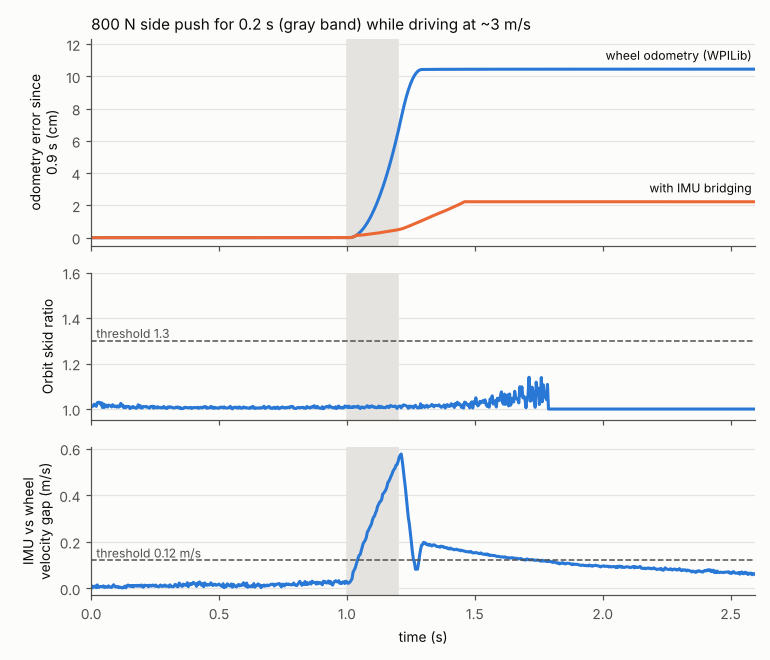

# Study: wheel slip, skids and collisions vs odometry-frame alignment

**Status:** simulation only, Oct 2026. Untested on a robot. Code:
[`tools/alignsim/studies/skid/`](../../../tools/alignsim/studies/skid/).

**Question.** The final approach tracks the target tag in the wheel-only odometry frame. Each frame
is placed with the odometry pose at capture time, then filtered, and the robot coasts on odometry
once the tag leaves view. How badly do wheel slip, skids and collisions corrupt that odometry, does
it break 1 cm alignment, and what should the robot do about it?

## Bottom line

- **Clean odometry is not the problem.**
  - Drift over the last second before "done" is 0.02 cm (p95 0.04).
  - Over a whole 4 m approach it is 0.2 cm (p95 0.4).
  - Heading stays under 0.25°, because it comes from the gyro.
  - Wheel-radius error (±2% gives 8 cm over 4 m) does not affect the odom-frame tracker at all
    (100% success). Frames keep arriving until the robot is about 3 cm from the goal.
- **Hard driving corrupts odometry, but early.** Accel limits of 10–12 m/s² and fast direction
  changes cost 2–35 cm, at the start of the approach. With accel 12 the tracker re-anchors on later
  frames and alignment stays at 100%. Direction reversals were only tested with cameras off.
- **Collisions near the target break alignment.** A 300–800 N push mid-approach or while coasting
  gives **32% false "done"**, with p95 true errors of 40–70 cm.
  - Pushes above about 500 N slide all four wheels together, and the encoders never see it.
  - A push that lands *while the tag is in view* is no safer: the robot steers to the wrong goal,
    loses the tag, and coasts there.
  - Pushes before the lock are harmless, as the design intends.
- **Detect with the IMU, not with wheel consistency.**
  - Orbit's skid ratio, the LS residual and stator current catch **~30%** of harmful skid episodes.
    They are blind when all four wheels slip together (pushes, launches, hard braking).
  - Comparing the Pigeon accelerometer with wheel-derived acceleration catches **95% (99% of those
    over 1 cm)** with **zero** clean-run false alarms and a 44 ms delay.
- **Respond by refusing to trust the lock, and bridge with the IMU.** Each mitigation was tested
  alone and in combination:

  | step | what it does | false done |
  |---|---|---|
  | (c) re-acquire alone | lock suspect after a skid; back off and re-lock if the tag is gone | 32% → **0%** in view, 10% coasting |
  | (f) IMU bridging alone | integrate the IMU through the skid | push-to-done drift p95 60–85 → **5 cm** |
  | (f)+(a)+(c) | the two above plus filter inflation | success 68% → **97%** in view, 90% coasting |
  | + 1 cm done gate | `pos_tol` tighter than the 2 cm scoring tolerance | coasting **95%** success / 5% false done |

  Inflating the tracker filter (a), dropping slipping modules (b) and trusting the global pose (e)
  change nothing.
- **Prevent cheaply.**
  - Set the drive slip current *below the sliding grip* (about 50–55 A here, not 120 A).
  - Keep the drive-to-pose accel ≤ 8 m/s².
  - *(Later, [controllers.md Q6](controllers.md#6-revisit-how-hard-can-it-accelerate-q5-q6): this
    plant had no weight transfer. With it, a low slip current starves the loaded wheels, so keep it
    high and limit acceleration in the command.)*
  - This keeps odometry clean on launches at no time cost, but it doesn't fix collisions.
- **100 Hz odometry (no CANivore) does not matter for alignment** (same success with and without
  pushes). It adds about 1 cm of drift during fast steering and halves IMU-bridge precision (p95
  5 → 10 cm).



*One 800 N side push (0.2 s) while driving. The wheels never see the slide (10 cm of error). The Orbit
skid ratio stays at 1.0–1.15 because all four wheels slide together. The IMU-vs-wheel velocity gap
jumps to 0.6 m/s within 20 ms. Bridging with the IMU leaves 2 cm.*

## Setup

- **Robot and approach:** alignsim's default `Scenario` and `VectorBrake` (vmax 3.5 m/s, accel
  6 m/s², decel 3 m/s²). The robot starts 2.8 m out at 1.5 m/s with two Limelight-like cameras.
  The design under test is `FrameTracker(frame="odom")`: a Kalman filter with a 25 cm jump gate
  that locks after 3 frames. The target tag leaves both cameras' view about 3 cm from the goal
  (0.37 m camera range). So the last ~0.3 s before "done" is pure coasting on odometry.
- **Contact:** stick/slip tread, μs 1.15 and μk 1.0, which gives 169 N of grip per wheel and 677 N
  for the whole robot before it breaks loose. The 120 A stator limit puts 309 N at the tread, 1.8×
  what the tire can hold. Wheels that spin make the encoders over-read. Sideways tread creep
  (4000 N per m/s) and sideways sliding are invisible to the encoders.
- **Odometry:** WPILib least squares with gyro heading, at 250 Hz (Q5: 100 Hz).
- **Collisions:** `plant.push(fx, fy, torque, duration)` of 300–800 N for 0.2–0.5 s. The direction
  is random in the field frame, and torque comes from a contact point up to ±0.3 m off center.
- **Sensors for the detectors** (on their own random stream, so the core trial is unchanged):
  - module speed and angle, plus 0.01 m/s and 0.15° noise;
  - Pigeon-like gyro rate, plus 0.005 rad/s noise;
  - an accelerometer synthesized from the true chassis acceleration, with 0.01 g white noise per
    250 Hz sample and a 0.01 g per-trial bias. The bias is learned online whenever no skid is
    flagged, and it starts already learned to within 0.002 g, as it would be after driving earlier
    in the match.
- **Plant fix:** every number here uses the fixed integration order (see [Core bugs](#core-bugs),
  now fixed in core). Before the fix, clean odometry looked about 4 mm worse after braking.
- **Samples:** n = 30–100 per row for odometry and detection (cameras off), and n = 60 per row for
  alignment (cameras on). Seeds 0..n−1 are the same in every variant, so rows are paired. Total
  compute was about 40 CPU-minutes.

## Q1. Odometry error budget

Cameras off; the robot drives 4 m to the goal on wheel odometry alone (about 2.2 s). "Drift" is
how far the odometry's own relative motion over a window differs from the true motion: the error
a frame captured at the start of the window would carry at its end. n = 30–100 per row.

| case | whole approach (4 m, ~2.2 s): median / p95 / max cm | last 1 s: median / p95 cm | slip ms |
|---|---|---|---|
| clean | 0.18 / 0.43 / 1.2 | 0.02 / 0.04 | 16 |
| clean, big turn (start heading ±90°) | 0.58 / 1.48 / 3.3 | 0.02 / 0.05 | 96 |
| wheel radius ±1% | 4.0 / 4.2 | 0.6 / 0.7 | 10 |
| wheel radius ±2% | 8.0 / 8.4 | 1.2 / 1.4 | 10 |
| accel limit 8 m/s² | 0.31 / 0.88 / 1.3 | 0.02 / 0.05 | 72 |
| accel limit 10 m/s² | 1.67 / 2.69 / 3.2 | 0.02 / 0.04 | 171 |
| accel limit 12 m/s² | 3.54 / 4.67 / 5.0 | 0.02 / 0.04 | 184 |
| 90° direction change at 2 m/s, accel 6 | 1.48 / 1.89 / 2.0 | 0.02 / 0.04 | 32 |
| 90° direction change at 2 m/s, accel 12 | 17.5 / 21.3 / 22.0 | 0.02 / 0.04 | 427 |
| 180° reversal at 2 m/s, accel 6 | 0.27 / 0.65 / 1.5 | 0.02 / 0.05 | 64 |
| 180° reversal at 2 m/s, accel 12 | 30.1 / 35.0 / 35.8 | 0.02 / 0.05 | 544 |
| push 300 N × 0.2 s | 0.27 / 0.63 / 0.8 | 0.04 / 0.37 | 15 |
| push 300 N × 0.5 s | 0.71 / 1.19 / 1.5 | 0.25 / 1.10 | 44 |
| push 500 N × 0.2 s | 1.7 / 7.3 / 12.6 | 0.06 / 5.0 | 145 |
| push 500 N × 0.5 s | 10.7 / 61 / 72 | 1.8 / 46 | 394 |
| push 800 N × 0.2 s | 17.5 / 44 / 50 | 1.5 / 35 | 346 |
| push 800 N × 0.5 s | 123 / 267 / 341 | 48 / 110 | 863 |

Pushes start at a random time 0.4–1.6 s in a random direction, with torque from a contact point up to
0.3 m off center. Heading drift is under 0.25° (p95) in every case, largest on the ±90° turn
(gyro scale error). Heading comes from the gyro, which slip does not affect.

**Against the ~1 cm the alignment needs:**
- **Clean:** 25–50× inside the budget.
- **Wheel-radius error:** 0.6–1.4 cm per final second looks over budget. But the tracker sees frames
  until about 3 cm from the goal, so the radius error only acts on the last ~3 cm (about 0.05 mm).
  Measured: ±2% radius gives 100% success and 0.8 cm p95, the same as 0%. It does matter for the
  *global* pose.
- **Hard launches and direction changes:** 2–35 cm. The last-second column stays clean because they
  happen at the start of the approach. What matters to the tracker is whether a disturbance falls
  between a frame's capture and the score.
- **Pushes over about 500 N:** 2–300 cm, which is 2 to 300× the budget. 300 N pushes stay near 1 cm.
  Those are sideways creep, not sliding.

## Q2. Effect on alignment

Default `Scenario`, odom-frame tracker, n = 60 per row. Each run gets one push of 300–800 N for
0.2–0.5 s in a random direction, with up to ±0.3 m of lever arm. The push fires at one of three
moments:

- **before lock:** 0.05–0.12 s;
- **in view:** the first loop where the measured goal distance is < 0.6 m and the tag was seen in the
  last 50 ms (about 0.9 s, camera about 1 m from the tag);
- **coasting:** the first loop where the tag has been unseen for ≥ 60 ms and the goal is < 10 cm away
  (about 1.6 s).

If a run locks or finishes before its trigger, it isn't pushed ("pushed %"). Success means done
with a true error under 2 cm and 1°. False done means it said done but was truly outside that.

| push moment | pushed % | skid flagged % | success % | false done % | true error at done, p95 cm | odometry drift push→done, p95 cm |
|---|---|---|---|---|---|---|
| no push | – | 0 | 100 | 0 | 0.8 | – |
| before lock | 92 | 73 | **100** | 0 | 0.9 | 59 |
| mid-approach, tag in view | 100 | 62 | **68** | **32** | 73 | 84 |
| late, coasting (tag out of view) | 90 | 47 | **68** | **32** | 39 | 63 |

Coasting pushes, split by force:

| force | n | success % | false done % | true error at done, p95 cm |
|---|---|---|---|---|
| 300–500 N | 26 | 77 | 23 | 5.6 |
| 500–680 N | 18 | 56 | 44 | 39 |
| 680–800 N (over the robot's grip) | 10 | 50 | 50 | 66 |

What happens:

- **Before lock: harmless, even though odometry is off by up to 59 cm.** Frames are only placed after
  the lock, so a jump before it just shifts the frame they live in. This is the design working as
  intended.
- **In view: just as bad as coasting.** The tag is in view when the push lands, but not afterwards.
  The odometry misses the slide, so the robot steers to a goal that is 10–130 cm off the real one.
  Close to the target the cameras then lose the tag, which is the same geometry that makes it leave
  view near the goal anyway. In all 19 failures the last frame arrived 0.2–0.4 s after the push,
  while the filter was still part-way through correcting. The robot then coasted to the wrong spot
  and declared done.
- **Coasting:** no frames can correct anything, so whatever the odometry missed becomes the scoring
  error.
- **The gate:** sub-friction pushes (300–500 N) still fail 23% of the time. Part of that is
  undetected sideways creep (1–3 cm). The other part has nothing to do with odometry: the robot is
  shoved off the goal, comes back, and the done gate (`pos_tol` 2 cm, the same number as the success
  threshold) fires at the edge. See the 1 cm gate test in Q4.

## Q3. Detection

Truth is a "skid episode": a stretch where the odometry misses more than 5 cm/s of the real motion
(gaps under 40 ms merged). An episode is caught if the alarm fires between 20 ms before it starts and
100 ms after it ends. Episodes come from the accel, direction-change and push rows of Q1 (radius-error
rows excluded). False alarms are counted on the 200 clean runs (normal approach plus big-turn
approach). The detectors only use what the robot can measure:

- **Orbit skid ratio:** `max|tᵢ| / min|tᵢ|` with `tᵢ = vᵢ − ω × rᵢ`, using the gyro rate. Computed only
  when `max|tᵢ| ≥ 0.25 m/s`, because below that the ratio is just noise.
- **Module deviation:** `max |tᵢ − median(t)|` in m/s. This is 135's version with module identity kept.
- **LS residual:** RMS residual of the 4-module least-squares chassis fit, in m/s.
- **IMU accel disagreement:** |IMU accel − wheel-derived accel|, each averaged over 40 ms.
- **IMU velocity disagreement:** a leaky integral (τ = 0.5 s) of (IMU accel − wheel accel), which
  amounts to |IMU velocity − wheel velocity|.
- **Stator current:** the largest module current as a fraction of the 120 A limit.
- **Commanded vs measured:** the largest module |target − measured wheel speed|.

| detector | episodes > 5 mm caught % | > 1 cm | > 2 cm | share of total missed error caught % | median delay ms | clean runs with an alarm % |
|---|---|---|---|---|---|---|
| Orbit skid ratio > 1.3 | 32 | 33 | 39 | 78 | 120 | 0 |
| module deviation > 0.25 m/s | 30 | 31 | 37 | 71 | 90 | 0 |
| LS residual > 0.05 m/s | 32 | 34 | 40 | 67 | 92 | 0 |
| stator current > 95% of limit | 39 | 37 | 42 | 21 | 16 | 12 |
| module commanded vs measured > 0.5 m/s | 36 | 35 | 39 | 21 | 16 | 6 |
| IMU accel disagreement > 3 m/s² | 96 | 100 | 100 | 100 | 24 | 0 |
| IMU velocity disagreement > 0.12 m/s | 96 | 99 | 100 | 100 | 40 | 0 |
| **sim rule (used by the Q4 runs):** IMU vel > 0.12 m/s OR IMU accel > 3 m/s² OR module dev > 0.25 m/s | **97** | **100** | **100** | **100** | **20** | **0** |
| kinematic only: ratio > 1.3 OR dev > 0.25 OR LS > 0.05 | 44 | 46 | 54 | 80 | 60 | 0 |
| Orbit skid ratio > 1.5 | 27 | 28 | 33 | 74 | 140 | 0 |
| IMU velocity > 0.15 m/s | 91 | 94 | 99 | 100 | 44 | 0 |
| IMU accel > 4 m/s² | 95 | 99 | 99 | 100 | 132 | 0 |
| **recommended start:** IMU vel > 0.15 OR IMU accel > 4 OR ratio > 1.5 | **95** | **99** | **99** | **100** | **44** | **0** |

Catch rate by disturbance, for each detector at the threshold shown (% of harmful episodes):

| detector | accel 12 m/s² | 90° change, accel 12 | push 500 N × 0.5 s | push 800 N × 0.2 s | push 800 N × 0.5 s |
|---|---|---|---|---|---|
| Orbit skid ratio > 1.3 | 0 | 2 | 79 | 70 | 88 |
| LS residual > 0.05 m/s | 35 | 0 | 54 | 40 | 80 |
| stator current > 95% | 71 | 0 | 0 | 0 | 0 |
| IMU accel > 3 m/s² | 100 | 100 | 100 | 100 | 100 |
| IMU velocity > 0.12 m/s | 100 | 100 | 96 | 98 | 100 |

Clean-run peaks, per run, as median / p95 / max:
- **Orbit skid ratio:** 1.15 / 1.22 / 1.30. That matches the community's 1.1–1.2 for translating and
  turning together, and 10% of clean runs pass 1.2.
- **IMU velocity disagreement:** 0.05 / 0.08 / 0.11 m/s on a normal approach, and a max of 0.11 on the
  big-turn approach.
- **IMU accel disagreement:** 0.9 / 1.6 / 2.0 m/s² on a normal approach, and a max of 2.7 m/s² on the
  big-turn approach.
- **Module deviation:** max 0.13 m/s normal and 0.18 big turn.
- **LS residual:** max 0.04 m/s.
- **Stator current:** 66% / 85% / 96% of the 120 A limit on a normal approach, and it hits 100% on
  big-turn approaches. `VectorBrake` already asks for more than the tread can give when it adds
  rotation, which makes current a noisy detector.

The 0.12 / 3.0 / 0.25 thresholds (the "sim rule" row) have little margin over those maxima. The
mitigation runs below use them and never false-flag. A real robot adds vibration, bumps and IMU
mounting flex, so start with the wider-margin row.

## Q4. Mitigations

All variants use the same detector (the "sim rule" from Q3) and the same seeds and pushes as Q2.

- **(a) Inflate:** while a skid is flagged and for 0.3 s after, the tracker's Kalman variance is
  raised to at least (5 cm)² and (2°)², so new frames dominate.
- **(b) Drop slipping modules:** modules whose translation is more than 0.15 m/s from the median get
  weight 0 in the least squares, keeping at least 2 modules.
- **(c) Re-acquire:** after a flagged skid the lock is *suspect* until 3 fresh frames arrive, and a
  suspect lock can't finish. If the tag is out of view (unseen > 60 ms) while the lock is suspect,
  the tracker drops its estimate and backs straight off 30 cm from where the robot is, facing the
  goal heading (heading is still good because it comes from the gyro). The robot then re-locks on
  new frames and approaches again.
- **(d) Traction-aware limits:** see the next table.
- **(e) Trust the global pose:** track the tag in the fused frame (`samplePoseAt`) and multiply the
  global vision std by 0.2 for 1 s after a skid.
- **(f) IMU bridging:** this one is not in the original list. While the skid flag is up, odometry
  translation comes from the accelerometer integrated from the last good wheel velocity. The
  50–100 ms before detection is replayed from a buffer. It hands back to the wheels once their
  acceleration matches the IMU's and the modules agree for 0.1 s, with a 2 s cap.

| variant | in view: success / false done / finished % | coasting: success / false done / finished % | drift push→done p95 cm (in view / coasting) |
|---|---|---|---|
| baseline | 68 / 32 / 100 | 68 / 32 / 100 | 84 / 63 |
| (a) inflate filter | 68 / 32 / 100 | 68 / 32 / 100 | 87 / 63 |
| (b) drop slipping modules | 68 / 32 / 100 | 68 / 32 / 100 | 85 / 63 |
| (c) re-acquire | 85 / **0** / 85 | 82 / 10 / 92 | 34 / 38 |
| (a)+(c) | 85 / **0** / 85 | 80 / 10 / 90 | 35 / 38 |
| (e) fused frame, trust vision 5× | 70 / 30 / 100 | 72 / 28 / 100 | 88 / 63 |
| (f) IMU bridging | 85 / 15 / 100 | 82 / 18 / 100 | **5.2 / 5.0** |
| **(f)+(a)+(c)** | **97 / 0 / 97** | **90 / 10 / 100** | **5.0 / 5.0** |

Before-lock pushes stay at 100% success for every variant tested. (f) cuts their odometry error from
59 to 6 cm (p95), but it didn't matter there. With no push, no skid is ever flagged. Baseline, (e) and
(f)+(a)+(c) were run and all give 100% success, 0.8 cm p95. The others are identical to the
baseline whenever nothing is flagged.

Coasting pushes, (f)+(a)+(c), split by force: 300–500 N 85 / 15 / 100; 500–680 N 89 / 11 / 100;
680–800 N **100 / 0 / 100** (baseline: 77/23, 56/44, 50/50). All 6 remaining false dones were pushes
the detector never flagged:
- 3 are the done-gate edge (error 2.0–2.2 cm, drift < 0.5 cm);
- 3 are sideways creep it can't see (drift 1.6–3.3 cm, error 2.2–3.6 cm).

### (d) Prevention: traction-aware limits

Each wheel holds 169 N before it breaks loose (μs 1.15) and only 147 N once it is sliding (μk 1.0).
The drive puts I × 2.58 N/A at the tread, so 65 A matches static grip and 57 A matches sliding grip.
The template's 120 A "slip current" is 1.8× what the tire can take.

Odometry drift with cameras off (n = 30, median / p95 cm, mean slip ms):

| drive setting | launch, accel 12 | 180° reversal at 2 m/s, accel 12 |
|---|---|---|
| slip current 120 A (template) | 3.2 / 4.5 (180 ms) | 29.5 / 32.6 (541 ms) |
| slip current 65 A (static grip) | 0.8 / 3.6 (109 ms) | 26.0 / 31.1 (503 ms) |
| slip current 55 A | 0.19 / 0.41 (50 ms) | 1.5 / 11.6 (263 ms) |
| slip current 50 A (under sliding grip) | **0.16 / 0.35** (19 ms) | **0.95 / 9.3** (150 ms) |
| 120 A, accel 8 | – | 0.9 / 2.2 (213 ms) |
| 120 A, accel 6 (default) | – | 0.21 / 0.60 (47 ms) |

- **Why 65 A isn't enough:** once a wheel slips, it only grips again if the motor can't push harder
  than sliding friction. So the limit has to sit *below the sliding grip*, not at the static grip.
- **No time cost:** with 50–55 A the camera-less approach still finishes in the same time (2.16 s
  against 2.2 s).
- **Alignment doesn't change.** With cameras on and no push, n = 60, every one of these gives 100%
  success and 0.8 cm p95: accel 6, accel 12, accel 12 + 65 A, accel 12 + (b), accel 12 + (f), and
  accel 6 + 65 A. The hard launch happens far from the target while frames still arrive, so the
  tracker re-anchors. Traction limits protect the *global* pose (paths, autos, the start of the
  approach). They are not what saves local alignment.

### Odometry-level comparison: (b) vs (f)

Cameras off, n = 30, drift over the whole approach (median / p95 cm):

| case | WPILib LS | (b) drop slipping modules | (f) IMU bridging | skid flagged % |
|---|---|---|---|---|
| clean, big turn | 0.4 / 1.2 | 0.4 / 1.2 | 0.4 / 1.2 | 0 |
| accel 12 | 3.2 / 4.5 | 3.2 / 4.5 | **0.3 / 0.5** | 100 |
| 90° change at 2 m/s, accel 12 | 17.1 / 20.2 | 17.1 / 20.3 | **1.4 / 2.0** | 100 |
| 180° reversal at 2 m/s, accel 12 | 29.5 / 32.6 | 29.5 / 32.7 | **1.0 / 2.0** | 100 |
| push 500 N × 0.5 s | 15.7 / 61.8 | 15.7 / 61.8 | **2.0 / 6.0** | 60 |
| push 800 N × 0.2 s | 20.2 / 45.6 | 20.2 / 45.6 | **2.1 / 3.8** | 100 |
| push 800 N × 0.5 s | 142 / 283 | 143 / 283 | **7.1 / 15.1** | 100 |

(b) does nothing because in every one of these events all four wheels slip together. The sim has no
weight transfer, which favors this, but a side push really does slide all four.

How the IMU bridge depends on IMU quality (median / p95 cm; clean-run alarms were 0% for every IMU):

| IMU | 180° reversal, accel 12 | push 800 N × 0.2 s | push 800 N × 0.5 s |
|---|---|---|---|
| noise 0.01 g, bias error 0.002 g (nominal) | 1.0 / 2.0 | 2.1 / 3.8 | 7.1 / 15.1 |
| noise 0.03 g, bias error 0.002 g | 1.1 / 2.2 | 2.4 / 3.5 | 7.4 / 15.6 |
| noise 0.01 g, bias error 0.01 g | 2.7 / 5.2 | 3.1 / 6.5 | 10.5 / 19.2 |
| noise 0.03 g, bias error 0.01 g | 2.5 / 5.1 | 3.2 / 6.4 | 10.9 / 18.5 |

Bias matters more than noise. Bridging cuts the error 10–20×, but it does not get back to 1 cm. The
IMU makes the odometry *usable* after a hit, not *precise*. That is why it is paired with (c).

### Done gate tighter than the success tolerance

Same coasting pushes, n = 60, with `pos_tol` set to 1 cm instead of 2 cm:

| case | success % | false done % | finished % | t_done s |
|---|---|---|---|---|
| no push, baseline, 1 cm gate | 100 | 0 | 100 | 1.85 (same as the 2 cm gate) |
| coasting push, baseline, 1 cm gate | 73 | 27 | 100 | 2.32 |
| coasting push, (f)+(a)+(c), 2 cm gate | 90 | 10 | 100 | 2.37 |
| coasting push, **(f)+(a)+(c), 1 cm gate** | **95** | **5** | 100 | 2.43 |

On a clean approach the robot is already inside 1 cm by the time it is slow enough to finish, so the
tighter gate costs nothing. After a shove, the tighter gate stops it declaring done at the edge. The
last 5% are sub-friction pushes whose creep nothing detects.

## Q5. SystemCore without a CANivore: 100 Hz odometry

The same experiments with `odom_period` = 10 ms. The detectors and the IMU bridge also run at
100 Hz, so the "40 ms" accel window becomes 100 ms.

| | 250 Hz | 100 Hz |
|---|---|---|
| clean drift, last 1 s, p95 cm | 0.04 | 0.06 |
| clean drift, whole 4 m approach, median / p95 cm | 0.18 / 0.43 | 0.18 / 0.57 |
| big-turn approach, median / p95 cm | 0.58 / 1.48 | 0.76 / 2.34 |
| 90° direction change at 2 m/s, accel 6, median / p95 cm | 1.48 / 1.89 | 2.32 / 2.64 |
| launches, reversals and pushes | (Q1) | within about 15% of 250 Hz |
| recommended detector: episodes > 1 cm / > 2 cm caught % | 99 / 99 | 78 / 97 |
| alignment, no push: success % | 100 | 100 |
| coasting push, baseline: success / false done % | 68 / 32 | 72 / 28 |
| coasting push, (a)+(c): success / false done / finished % | 80 / 10 / 90 | 80 / 5 / 85 |
| coasting push, (f)+(a)+(c): success / false done % | 90 / 10 | 95 / 5 |
| coasting push, (f)+(a)+(c): drift push→done p95 cm | 5.0 | 10.1 |
| t_done, no push, s | 1.85 | 1.83 |

- **For alignment it does not matter.** Success and false done move by less than the ±6 point noise,
  with and without pushes and mitigations.
- **New non-slip error.** WPILib odometry multiplies each module's distance step by its angle *at the
  end* of the step. With 10 ms steps, fast steering adds about 1 cm per direction change. The wheels
  aren't slipping, so the IMU agrees with them and no detector flags it (it accounts for most of the
  drop in the 1 cm catch rate). It happens early in the approach, so the tracker doesn't care.
- **Detection and bridging get coarser.** Marginal launch slips at 10 m/s² are caught 39% of the time
  instead of 99%. Collision drift after IMU bridging doubles (p95 5 → 10 cm).
- **Verdict:** a CANivore is not needed for local alignment. If the robot adopts IMU bridging, or
  leans on the global pose during aggressive driving, prefer 250 Hz.

## Recommendations

In priority order. The thresholds are starting points: log every signal, then set each one to about
1.5–2× the largest value seen in clean match driving.

1. **Keep the odom-frame design.**
   - Clean odometry is about 50× better than the 1 cm budget over the last second.
   - Corruption before lock is harmless.
   - Wheel-radius error does not matter to the local tracker.
   - What breaks it is a hit near the target. Design for that.
2. **Add an IMU skid detector at the odometry rate.** It compares the Pigeon 2 accelerometer with
   the acceleration implied by the wheels, in the field frame. Fire on any of these:
   - **velocity disagreement** > **0.15 m/s**: the leaky integral (τ = 0.5 s) of
     (IMU accel − wheel accel), with the IMU bias learned while no skid is flagged;
   - **40 ms average accel disagreement** > **4 m/s²**;
   - **Orbit skid ratio** > **1.5**, computed only while `max|tᵢ| ≥ 0.25 m/s`. It is cheap insurance
     for one-wheel events, which a real robot with weight transfer will have more of than this sim.

   Hold the flag for 0.15 s. Do **not** rely on the skid ratio, the LS residual or stator current
   alone: they miss every all-four-wheel slide, and that is what pushes, launches and hard braking
   produce.
3. **(c) Treat the lock as suspect after any flagged skid.** A suspect lock can't finish until 3
   fresh frames arrive. If the tag is out of view while the lock is suspect, drop the estimate,
   back straight off about 30 cm facing the goal heading, re-lock and approach again. This alone
   takes false done from 32% to 0% (in view) and 10% (coasting). If backing off doesn't bring the
   tag back, hand control to the driver.
4. **Make the done gate tighter than the scoring tolerance** (`pos_tol` 1 cm when scoring needs
   2 cm). It costs no time on a clean approach and takes the remaining false dones from 10% to 5%.
5. **(f) Prototype IMU bridging, logged in parallel first.**
   - **What it does:** while the flag is up, integrate the accelerometer from the last good wheel
     velocity, replay the 50–100 ms before detection, and hand back when the wheels' acceleration
     matches again.
   - **Why it matters:** it cuts collision drift 10–20× (p95 60–85 → 5 cm), so the robot ends up
     near the goal and (c) can re-lock quickly. With (c) and the 1 cm gate, coasting pushes go from
     68% to 95% success.
   - **When to trust it:** only after logs show the IMU agrees with the wheels to about 0.05 m/s in
     clean driving and the bias estimate holds.
6. **Set the drive "slip current" below the sliding grip, not at 120 A.** On this robot that is about
   50–55 A, roughly μk·m·g/4 converted to stator current. Measure it on carpet: ramp the current
   until a wheel spins, then use about 85% of that. Keep the drive-to-pose accel ≤ 8 m/s² (0.7 g)
   with `VectorBrake`'s default 6 as the norm. It costs nothing in approach time and keeps the
   global pose clean. It does not change local alignment, because hard launches happen while frames
   still arrive. *(Later, controllers.md Q6: with weight transfer modeled, a low slip current is worse,
   not better. The template keeps 120 A and limits acceleration in `DriveToPose`.)*
7. **Don't bother with these:**
   - (a) inflating the tracker filter: after a real hit there are no good frames left to use;
   - (b) dropping slipping modules: all four slip together;
   - (e) trusting the global pose more: far field tags are too weak near the goal to help.
8. **Odometry rate** (SystemCore without CANivore): see Q5.

## Caveats

- **The IMU is idealized:** white noise plus a constant bias. There are no impact spikes, no
  saturation (the Pigeon 2 accelerometer is ±2 g, and a bumper hit can exceed that briefly), no
  vibration, no mount flex and no tilt (1° of tilt leaks 0.017 g of gravity). The sensitivity rows
  show the bridge degrading with bias. Treat the IMU thresholds as starting points to tune from
  logs, and treat (f) as a prototype to log in parallel before it drives anything.
- **The plant has no weight transfer, no wall or element contact, and the same carpet μ
  everywhere.** That is why all four wheels slip together on launches and reversals. That makes the
  kinematic checks (Orbit ratio, LS residual, dropping modules) look worse than they will on a real
  robot, where slip is more one-sided. A side push really does slide all four wheels together,
  though.
- **Sub-friction sideways creep uses a guessed viscous tread model** (4000 N per m/s per wheel).
  The 0.3–2 cm from 300–500 N pushes, and the residual false dones it causes, may be smaller on
  carpet.
- **Pushes are a constant force for a set time.** Real defense is a contact with stiffness, often
  from the side, and the defender can also block the camera.
- **n = 60 per alignment row** gives about ±6 points (1σ) on success %. Differences under about 10
  points are noise. Rows share seeds and pushes, which makes paired comparisons tighter than that.
- **The re-acquire behavior is minimal.** It needs a real fallback (driver, or the global goal) for
  the 3% of very large shoves (60–130 cm) where backing up 30 cm doesn't bring the tag back into
  view.

## Core bugs

Both were fixed in core after this study; the numbers above already used the fixes.

1. **`tools/alignsim/plant.py`, integration order.**
   - **What:** `SwervePlant.step` integrates the encoders with the contact speed from *before* the
     velocity update (lines 145 and 152), but moves the chassis with the velocity from *after* it
     (lines 162–167, semi-implicit Euler). So a wheel that rolls without slipping disagrees with the
     true travel by (v_start − v_now) × sim_dt. That is about 4 mm after braking from 2 m/s, and it
     appears in every study as fake odometry error.
   - **Fix:** move the pose with the pre-update velocity (save `vx, vy, w` before the update and use
     them for `x, y, th`), or integrate `drive_dist` with the post-update contact speed.
   - **Size:** in this study, clean drift over the last 1 s goes from 0.38 cm (bug) to 0.02 cm
     (fixed). The default alignment success didn't change measurably (n = 30).
   - **Status:** fixed in core (the pose now moves with the pre-update velocity; regression test
     `test_encoders_read_true_travel_while_moving`). `FixedPlant` is now an alias of `SwervePlant`.
2. **`tools/alignsim/world.py`, lines 101–102.**
   - **What:** `World.__init__` replaces `RobotParams.wheel_radius_error` and `gyro_scale_error` with
     fresh random draws, so a fixed value set on `Scenario.robot` is silently ignored.
   - **Fix:** add the draw to the configured value.
   - **Status:** fixed in core. `Config.radius_error` still pins the value exactly.
3. *(Fixed in core during this study by the coordinator: `geom.twist_log` division by zero for tiny
   turns.)*

## Reproduce

From `tools/`:

```bash
export SKID_OUT=/tmp/skid                                   # result caches (pickles)
python3 alignsim/studies/skid/q1_q3_budget_detect.py        # Q1 budget + Q3 detection (~3 CPU-min)
python3 alignsim/studies/skid/q1_q3_budget_detect.py 1 --period 0.010   # Q5: 100 Hz
python3 alignsim/studies/skid/q4_odometry.py 30             # Q4 odometry-level + IMU sensitivity
python3 alignsim/studies/skid/q2_q4_alignment.py phases 60  # Q2 + Q4 (~15 CPU-min)
python3 alignsim/studies/skid/q2_q4_alignment.py accel 60   # Q4 (d)
python3 alignsim/studies/skid/q2_q4_alignment.py radius 60
python3 alignsim/studies/skid/q2_q4_alignment.py gate 60
python3 alignsim/studies/skid/q2_q4_alignment.py rate 60    # Q5: 100 Hz alignment
python3 alignsim/studies/skid/fig_push_trace.py             # the figure
```

`skidsim.py` holds the pieces:
- `SkidWorld`, a copy of `World.run` with hooks for pushes, the detectors and the odometry variants;
- `Monitor`, the detectors and IMU bridging;
- `SkidOdometry`;
- `SkidTracker`, for (a) and (c);
- `SkidGlobalVision`, for (e);
- `FixedPlant` (now just the core `SwervePlant`).
